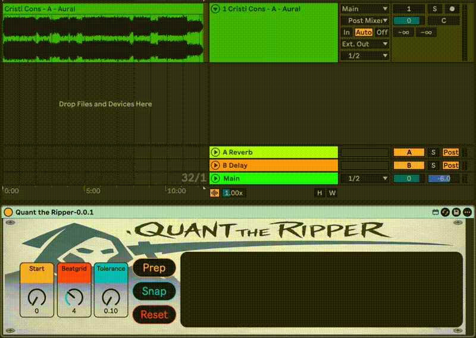
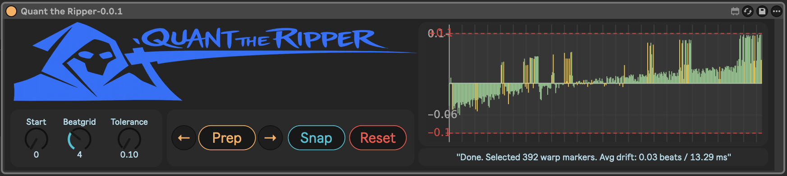
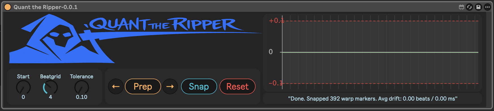

# Quant the Ripper
A Max For Live device to quantize and warp audio with varying drift (e.g. vinyl rips)



## Overview
Quant the Ripper matches warp markers to a beat grid, keeps the ones that fit, and snaps them onto the grid:

* follows slow drift (a rip running slightly fast or slow) instead of comparing against a fixed grid
* can find the kicks in the audio itself and add them as warp markers
* removes unneeded markers
* flags drift outliers and gaps without a marker
* snaps accepted markers to the grid, fully or part of the way

The workflow is designed for techno / 4x4 material where timing consistency matters but full-track warping is too destructive or inconsistent.

## Controls
Left to right, in the order you use them:
- **Prep section**
  - **Beatgrid**: grid interval: 1/4, 1/2, 1 bar, 2 bars or 4 bars
  - **Tolerance**: how far (ms) a marker may be from where it is expected; limited to less than half the grid
  - **Detect** (on by default): Prep finds the kicks in the audio file and adds them as warp markers. Turn off to use only the markers already on the clip
  - **Prep**: see below
- **Snap section**
  - **Strength**: how far Snap moves markers toward the grid (100% = onto the grid)
  - **Re-Pitch** (on by default): Snap sets the quanted clip to Re-Pitch warp mode, which follows speed changes like a turntable
  - **Snap**, **Reset**: see below
- **Graph**: drift per grid point (green kept, red missing, yellow outlier, grey band = tolerance around the expected drift); click a bar to jump there, click again to zoom out
- **← →** either side of the status line: step through outliers and gaps

The grid starts at 1.1.1 when the markers fit it, otherwise at the first kick. Drift is always followed: each marker is expected where the previous markers' drift predicts.

## Step-by-step
1. Select an Arrangement audio clip with Warp on
2. Leave **Detect** on, or turn it off and add all transients as warp markers yourself (Sample view, select the whole sample, right click > Insert Warp Marker(s) / Cmd+I)
3. Click Prep

   - Duplicates the clip to a _prepared track right below the original
   - With Detect on, finds the kicks and adds them as warp markers on the _prepared clip
   - Finds where the grid starts (1.1.1, or the first kick)
   - Matches one marker to each grid point, within tolerance of where it is expected
   - Removes the markers that were not matched
   - Flags outliers (isolated flips, local spikes, sudden jumps against the trend) and gaps (grid points without a marker)
4. Review the graph and step through outliers and gaps

   - ← → step through outliers and gaps and move the Arrangement playhead to each one
   - Make manual modifications on the _prepared clip as needed
   - Click Prep again to reanalyze the _prepared clip (manual edits are kept)
   - Changing Beatgrid, Tolerance or Detect and clicking Prep rebuilds the _prepared clip from the original
5. Click Snap

   - Re-reads the _prepared clip, so edits made since the last Prep are included
   - Creates a _quanted version below it
   - Moves the markers onto the grid (or part of the way, with Strength below 100%)
6. Click Reset to delete the _prepared and _quanted tracks

## Limitations
- Kick detection looks at the low end (below about 150 Hz); it works best on four-to-the-floor material with a clear kick. Without Detect the device depends on Ableton's transient markers
- Drift tracking follows speed changes up to 2% per beat; sudden jumps (a skip, an edit) show up as outliers or gaps
- Kick detection and the `add_warp_marker` call it uses need Live 11 or later

## Installation
- Download it from MaxForLive: https://maxforlive.com/library/device/15084/quant-the-ripper

## Build
- `device/Quant the Ripper.maxpat`: patcher source, readable in diffs
- `device/Quant the Ripper.amxd`: the device, packed from the `.maxpat`
- `src/`: TypeScript for `quant.js` (device logic) and `graph.js` (drift graph), compiled into `device/`

```bash
npm ci
npm run build
```

Open `device/Quant the Ripper.amxd` in Live; it loads `quant.js` and `graph.js` from the same folder.

After editing the device in Max, save it and extract the patcher so the change shows up in git:
```bash
npm run device:unpack
```

After editing the `.maxpat` by hand, rebuild the device:
```bash
npm run device:pack
```

Tests run the compiled scripts under Node against an in-memory mock of the Live API, and check that every message the patch sends has a handler and that the `.amxd` matches the `.maxpat`:
```bash
npm test
```

Click the `debug 1` message box in the patcher to print verbose diagnostics to the Max console (`debug 0` turns it off).

For a release, open the device in Max, Freeze it so the scripts are embedded, and save the frozen copy outside the repo for upload.

## Licence
Apache-2.0, see [LICENSE](LICENSE).
